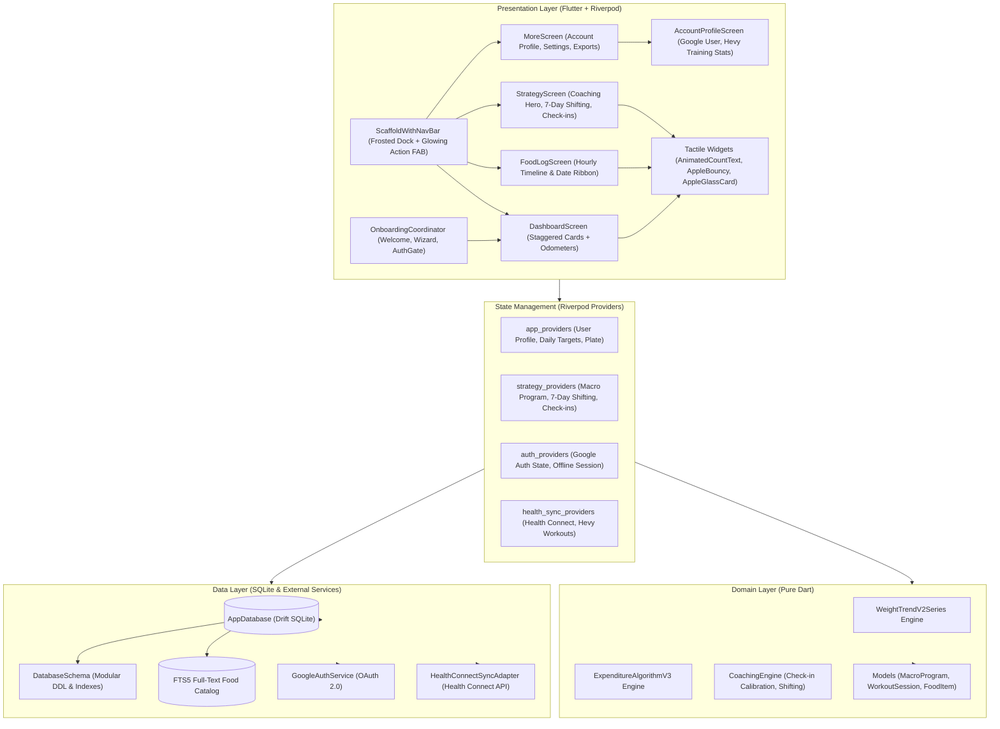

# MacroFactor (Indian Edition) • 1:1 Clean-Room Flutter Reconstruction

<div align="center">


<br/>

**A clean-room 1:1 visual & UX reconstruction of MacroFactor for Android & iOS, featuring authentic Obsidian dark UI, Apple HIG tactile animations, Liquid Glass frosted surfaces, an adherence-neutral Strategy Coaching Engine, Google Sign-In, Health Connect Hevy workout sync, and a 2,500+ Indian food database (ICMR-NIN IFCT) with 1-tap cooking oil modifiers.**

<br/>

[📥 **Download Production APK (v1.7.0)**](https://github.com/h4rysh/macrofactor-flutter/releases/download/v1.7.0/app-release.apk) • [🏷️ **Releases & Changelog**](https://github.com/h4rysh/macrofactor-flutter/releases) • [📐 **Mathematical Formulations**](#-mathematical-formulations) • [🏛️ **System Architecture**](#️-system-architecture) • [🚀 **Quick Start**](#-quick-start--development)

</div>

---

## 📑 Table of Contents

- [✨ Core Capabilities & Highlights](#-core-capabilities--highlights)
- [📱 Visual & UX Reconstruction (Liquid Glass & Apple HIG)](#-visual--ux-reconstruction-liquid-glass--apple-hig)
- [🧠 Philosophy: Adherence-Neutral Nutrition](#-philosophy-adherence-neutral-nutrition)
- [🎯 MacroFactor Strategy Coaching Engine & 7-Day Shifting](#-macrofactor-strategy-coaching-engine--7-day-shifting)
- [🚀 First-Launch Onboarding & Interactive Goal Direction](#-first-launch-onboarding--interactive-goal-direction)
- [🏋️ Google Sign-In, Health Connect & Hevy Sync](#️-google-sign-in-health-connect--hevy-sync)
- [🍛 HealthifyMe-Grade Indian Food Database](#-healthifyme-grade-indian-food-database)
- [📐 Mathematical Formulations](#-mathematical-formulations)
- [🏛️ System Architecture](#️-system-architecture)
- [🗄️ Database Schema & Storage Architecture](#️-database-schema--storage-architecture)
- [🧪 Verification & Quality Gates](#-verification--quality-gates)
- [🚀 Quick Start & Development](#-quick-start--development)
- [📄 License & Disclaimers](#-license--disclaimers)

---

## ✨ Core Capabilities & Highlights

| Feature Area | Implementation Highlights |
|---|---|
| **🎨 Apple HIG Motion & Glass** | Authentic Obsidian OLED Dark palette (`#0B0B0E`), frosted `BackdropFilter` docks (sigma 18–20), `AppleBouncy` tactile micro-interactions, `AnimatedCountText` numerical odometer tweens, and `MacroGaugeRing` concentric radial progress sweep. |
| **🧠 Adherence-Neutral Coaching** | Mathematical calibration without red warning flags or calorie guilt. 3 Coaching Modes (Coached, Collaborative, Manual), 5 Macronutrient Styles (Balanced, Low Fat, Low Carb, Ketogenic, High Protein), and 7-day calorie shifting with strict energy conservation. |
| **🚀 First-Launch Onboarding** | Interactive 6-step goal direction wizard (`OnboardingCoordinator`, `WelcomeScreen`, `StrategySetupWizard`, `AuthGateScreen`) with adaptive pacing, Indian dietary preferences, and instant target activation. |
| **🏋️ Wearable & Training Sync** | Google OAuth Sign-In with 100% offline SQLite session caching, Android Health Connect sync importing Hevy workout sessions (`ExerciseSessionRecord`), body weight sync with conflict protection, and an Account Profile training dashboard. |
| **🍛 2,500+ Indian Food Items** | Embedded SQLite FTS5 full-text search curated from ICMR-NIN IFCT tables, native Indian portion units (*katori*, *roti*, *ladle*, *cups*), and a 1-tap cooking oil modifier (+½ tsp, +1 tsp, +1 tbsp oil/ghee). |
| **📈 Dynamic Metabolic Filtering** | Bidirectional zero-phase EMA weight trend smoothing with dynamic $\Delta t$ interval scaling and Bayesian Kalman filter (V3) state estimation for Total Daily Energy Expenditure (TDEE). |

---

## 📱 Visual & UX Reconstruction (Liquid Glass & Apple HIG)

Engineered through systematic clean-room reverse engineering analysis of the authentic application topology, design tokens, and user experience patterns:

```
Obsidian Base:     #0B0B0E  (True deep OLED dark)
Elevated Cards:    #16161C  (Subtle elevated surface)
Hairline Borders:  #26262E  (1px translucent micro-dividers)
Macro Accents:     🔥 #FF5722 Cal  •  🍗 #FB923C Protein  •  🥑 #FACC15 Fat  •  🌾 #38BDF8 Carbs  •  ⚡ #0055E1 Expenditure
```

### Apple HIG Tactile Motion & Liquid Glass Surfaces
- 🪟 **Liquid Glass Frosted Docks**: Gaussian blurs (`BackdropFilter` sigma 18–20) paired with specular translucent highlight borders on `PersistentSearchBar` and `ScaffoldWithNavBar`.
- ⚡ **Odometer Number Tweens (`AnimatedCountText`)**: Numerical count-ups for calories and macronutrients powered by `Curves.easeOutCubic`.
- 🌊 **Staggered Page Reveals (`AppleStaggeredEntrance`)**: Cascading slide-fade reveals on page loads across Dashboard, Strategy, and More screens.
- 🎯 **Tactile Micro-Interactions (`AppleBouncy`)**: Zero-delay spring scale-down on tap that participates directly in Flutter's gesture arena (`onTapDown`, `onTapUp`, `onTapCancel`), preventing false triggers or stickiness in scrollable views.
- ⭕ **Animated Macro Gauge Ring (`MacroGaugeRing`)**: Concentric radial progress sweep, over-target accent arcs, and centered calorie odometers.
- ⏱️ **Boot to Food Log**: Default startup launches directly into the hourly food timeline with instant navigation back to the Dashboard.

---

## 🧠 Philosophy: Adherence-Neutral Nutrition

Traditional nutrition applications punish the user with bright red "over-budget" rings, guilt-inducing alerts, and arbitrary calorie deductions. When life happens and a meal is over-eaten, traditional apps ask you to starve the next day—perpetuating the restrict-binge cycle.

**MacroFactor does not judge. MacroFactor calculates.**

```
Traditional Apps:      Calories Consumed > Target  ➜  Red Shame Screen  ➜  Cut Next Day Calories
MacroFactor Engine:    Calories Consumed > Target  ➜  Observe Weight    ➜  Update Metabolic Model
```

Every day is treated as an **informative data observation**. If you ate 3,500 kcal and did not gain weight, the algorithm recognizes your metabolic expenditure is higher than anticipated and adjusts your targets **up**, not down.

| Attribute | Traditional Apps (MyFitnessPal, LoseIt) | MacroFactor (Indian Edition) |
|---|---|---|
| **Goal Deviations** | Red warning badges, deficit penalties | Adherence-neutral mathematical calibration |
| **Expenditure Model** | Static formula calculated once (Harris-Benedict) | **Dynamic Bayesian Kalman Filter** continuously adapting |
| **Scale Weight** | Raw noisy scale readings cause panic | **Bidirectional Zero-Phase EMA** with noise envelopes |
| **Coaching Strategy** | Rigid, static calorie allotments | **Adaptive Bayesian Coaching Engine** with 7-day shifting |
| **Indian Nutrition** | Crowdsourced, inaccurate generic entries | Verified **ICMR-NIN IFCT standards** with katori & piece portions |
| **Cooking Fat** | Unaccounted or manual tedious oil entry | **1-Tap Oil Modifier** (+½ tsp, +1 tsp, +1 tbsp) |
| **Fitness Wearable Sync** | Fragmented, proprietary cloud sync | **Offline-first Google Health Connect + Hevy Sync** |

---

## 🎯 MacroFactor Strategy Coaching Engine & 7-Day Shifting

The Strategy system provides an adherence-neutral virtual coach that calibrates macro targets weekly based on observed scale weight trend and logged caloric intake:

### 1. Three Coaching Modes
- **Coached**: MacroFactor dynamically updates your calorie targets and macro splits every week based on metabolic expenditure.
- **Collaborative**: You set your preferred weekly calories; MacroFactor dynamically solves and distributes your daily macros.
- **Manual**: Complete sovereignty over daily targets while retaining expenditure and trend analytics.

### 2. Five Macronutrient Distribution Styles
- **Balanced**: Moderate carbohydrates, moderate fats, optimal protein ($1.6\text{--}2.2\text{ g/kg}$).
- **Low Fat**: Prioritizes complex carbohydrates while maintaining essential fatty acid minimums ($0.5\text{ g/kg}$).
- **Low Carb**: Restricted carbohydrate ceiling with elevated fats for sustained satiety.
- **Ketogenic**: Strict $<30\text{ g}$ net carbs with high healthy fats.
- **High Protein**: Elevated protein ceiling ($2.2\text{--}2.7\text{ g/kg}$) for athletic muscle retention.

### 3. Strict 7-Day Calorie Shifting Conservation
Allows users to allocate higher calories to heavy workout days or social weekends while reducing rest day targets, adhering to strict mathematical energy conservation:

$$\sum_{d=1}^7 \text{Calories}_d = 7 \times \text{DailyAverageCalories}$$

Day-shifted macro targets reactively propagate from `dayMacroTargetForSelectedDateProvider` directly to the active Dashboard!

### 4. Robust Macro Solver Guardrails
- **Minimum Carbohydrate Safety Floor**: Guarantees $\ge 20\text{g}$ carbohydrates even on high-protein, low-calorie diets to prevent metabolic hypoglycemia.
- **High-Calorie Bounds Scaling**: Expands upper bounds on protein (1,000g), carbohydrates (2,000g), and fat (1,000g), preventing premature clipping bugs at 5,800+ kcal athlete regimens.
- **Residual Energy Balancer**: Automatically balances residual calories from integer rounding within $\pm 2\text{ kcal}$.

---

## 🚀 First-Launch Onboarding & Interactive Goal Direction

To ensure every user begins with a personalized, calibrated metabolic baseline, the application features an interactive onboarding flow and dynamic goal questionnaire:

### Multi-Step Onboarding Architecture
- **`WelcomeScreen`**: Introduces MacroFactor's adherence-neutral philosophy and clean-room science with smooth slide-fade animations.
- **`StrategySetupWizard`**: Guides users through baseline biometric entry (height, weight, biological sex, age) and expenditure estimation.
- **`AuthGateScreen`**: Offers Google OAuth Sign-In or one-tap local Guest Mode, ensuring 100% offline sovereignty.

### Interactive 6-Step Goal Questionnaire Sheet
1. **Goal Selection**: Fat Loss, Maintenance, or Muscle Gain with physiological guidance.
2. **Activity & Expenditure**: Baseline multiplier calculation accounting for daily occupation and structured training.
3. **Adaptive Pacing**: Safe weekly rate of change slider bounded by health recommendations (0.25% to 1.0% body weight/week).
4. **Indian Dietary Preferences**: Vegetarian, Eggetarian, Non-Vegetarian, Halal, or Jain options with customized protein suggestions.
5. **Protein Strategy**: Protein target selection ranging from standard RDA to athletic hypertrophy tiers ($1.6\text{--}2.7\text{ g/kg}$).
6. **Summary & Activation**: Real-time preview of daily calories and macros with instant auto-save to Riverpod state and SQLite.

---

## 🏋️ Google Sign-In, Health Connect & Hevy Sync

### Local-First Sovereign Authentication
- **Google OAuth Sign-In**: Seamless authentication linking Google Avatar, Name, and Email.
- **100% Offline Sovereignty**: Account sessions are cached locally in SQLite (`user_account_session`). The app functions completely offline, with one-tap sign-out returning to local guest mode without data loss.
- **Demo Athlete Mode**: Instant one-tap evaluation profile with pre-seeded metabolic logs and Hevy workout data.

### Google Health Connect Integration
- **Background Sync**: Quietly synchronizes on app launch and app resume via `AppLifecycleSyncObserver`.
- **Manual Sync**: Dedicated "Sync Now" button inside Settings to avoid UI clutter.
- **Hevy Workout Import**: Automatically ingests `ExerciseSessionRecord` events logged by Hevy in Health Connect, tracking session title, duration, active calories burned, and timestamps.
- **Smart Scale Ingestion with Conflict Protection**: Automatically reads scale weight recordings into the local `scale_weights` table. A conditional SQLite conflict policy ensures background syncs never overwrite user-entered manual weigh-ins:
  ```sql
  ON CONFLICT(date) DO UPDATE SET
    scale_weight = excluded.scale_weight,
    note = excluded.note,
    source = excluded.source,
    logged_at = excluded.logged_at
  WHERE weight_logs.source != 'manual' OR excluded.source = 'manual';
  ```

### Account Profile & Training Dashboard
- Total workouts synced from Hevy.
- Total workout minutes and average duration per training session.
- Weekly workout consistency and frequency tracker.
- Total and average active calories burned per workout.
- Recent Hevy workout history feed with Apple Glass cards.

---

## 🍛 HealthifyMe-Grade Indian Food Database

### 2,500+ ICMR-NIN IFCT Food Items
- Embedded offline **SQLite FTS5 full-text search engine** containing **2,500+ Indian & Global food items**.
- Curated using the **National Institute of Nutrition (ICMR-NIN) Indian Food Composition Tables (IFCT)**.
- Authentic regional cuisine coverage:
  - **South Indian**: Dosa, Idli, Medu Vada, Sambar, Rasam, Pongal, Appam, Avial, Poriyal, Chettinad Chicken, Fish Curry.
  - **North Indian**: Paneer Butter Masala, Dal Makhani, Rajma, Chole, Palak Paneer, Roti, Naan, Paratha, Biryani, Pulao.
  - **Snacks & Street Food**: Samosa, Dhokla, Pani Puri, Bhel Puri, Pav Bhaji, Kathi Roll.
- Native portion units: *Katori (150 ml)*, *Roti / Chapati (count)*, *Dosa / Idli (piece)*, *Ladle (60 ml)*, *Grams*, *Cups*.

### 1-Tap Cooking Oil Modifier
Home-cooked Indian meals frequently vary in oil and ghee usage. Instead of breaking down a dish into its raw ingredients every time:
- Select any dish (e.g. *Bhindi Masala* or *Egg Curry*).
- Tap the **Oil Modifier**:
  - `No Extra Oil` (Base recipe)
  - `+½ tsp Oil / Ghee` (+22.5 kcal, +2.5g fat)
  - `+1 tsp Oil / Ghee` (+45.0 kcal, +5.0g fat)
  - `+1 tbsp Oil / Ghee` (+120.0 kcal, +14.0g fat)
- The nutrition aggregate updates instantaneously in memory.

---

## 📐 Mathematical Formulations

### A. Exponential Moving Average with Dynamic $\Delta t$ Interval Scaling
For consecutive scale weights $w_t$ sampled at non-uniform intervals $\Delta t$:

$$\alpha_{\text{scaled}} = 1 - (1 - \alpha_0)^{\Delta t}$$

$$\text{EMA}_t = \alpha_{\text{scaled}} \cdot w_t + (1 - \alpha_{\text{scaled}}) \cdot \text{EMA}_{t-1}$$

Zero-phase backward smoothing pass:

$$\text{Smoothed}_t = \frac{1}{2} \left( \text{EMA}_t^{\text{forward}} + \text{EMA}_t^{\text{backward}} \right)$$

### B. Bayesian Kalman State Estimation for TDEE (V3)
The latent state $x_k$ (Expenditure in kcal/day) is tracked through a transition and measurement model:

$$\text{Prior State}: \quad \hat{x}_{k|k-1} = \hat{x}_{k-1}$$

$$\text{Prior Covariance}: \quad P_{k|k-1} = P_{k-1} + Q_k$$

$$\text{Observed Expenditure}: \quad z_k = C_k - \kappa \cdot \Delta w_k \quad (\kappa = 7700\text{ kcal/kg})$$

$$\text{Kalman Gain}: \quad K_k = \frac{P_{k|k-1}}{P_{k|k-1} + R_k}$$

$$\text{Posterior Update}: \quad \hat{x}_k = \hat{x}_{k|k-1} + K_k (z_k - \hat{x}_{k|k-1})$$

$$\text{Flux Clamp}: \quad \Delta x_k = \text{clamp}(\hat{x}_k - \hat{x}_{k-1}, -150, +150)$$

---

## 🏛️ System Architecture



---

## 🗄️ Database Schema & Storage Architecture

The local database is engineered with **Drift & SQLite3** under a strict **offline-first sovereignty** principle, with schema statements decoupled into [`database_schema.dart`](lib/data/local/database_schema.dart):

```
app_database.sqlite
 ├── user_profiles          (Biometrics, calorie floor, goal pace)
 ├── app_settings           (Key-value configuration & preferences)
 ├── weight_logs            (Scale weights with source tracking: manual vs health_connect)
 ├── food_logs              (Logged foods grouped by date, hour, meal slot, and oil modifier)
 ├── food_catalog           (Embedded ICMR-NIN IFCT food items with FTS5 virtual search)
 ├── workout_sessions       (Hevy exercise sessions synced from Health Connect)
 ├── user_account_session   (Cached Google profile, avatar, and token state)
 ├── macro_programs         (Active coaching plans, styles, and shifting targets)
 └── coaching_checkins      (Weekly metabolic adjustment history)
```

---

## 🧪 Verification & Quality Gates

Every commit passes automated local verification and GitHub Actions CI pipelines:

| Check | Tool / Standard | Result |
|---|---|---|
| **Static Code Analysis** | `flutter analyze` | **0 issues found** (Clean) |
| **Automated Test Suite** | `flutter test` | **320+ Passing Unit, Widget & E2E Tests** |
| **Code Formatting** | `dart format .` | **Enforced in CI (`--set-exit-if-changed .`)** |
| **Modularity Ceiling** | Architectural Rule | **100% of files strictly $\le 800$ lines** |
| **Android Release Build** | `flutter build apk --release` | **Clean exit (`app-release.apk`)** |
| **CI Automation** | GitHub Actions (`Flutter CI`) | **All CI workflow steps green** |

---

## 🚀 Quick Start & Development

### Prerequisites
- [Flutter SDK](https://docs.flutter.dev/get-started/install) 3.29.0 or higher
- Android SDK 34 / Java 17

### 1. Clone & Install Dependencies
```bash
git clone https://github.com/h4rysh/macrofactor-flutter.git
cd macrofactor-flutter
flutter pub get
```

### 2. Verify Code Quality & Tests
```bash
# Verify formatting across all files
dart format --output=none --set-exit-if-changed .

# Run static analysis
flutter analyze

# Run unit, widget, and E2E journey tests
flutter test

# Run with test coverage report
flutter test --coverage
```

### 3. Run on Emulator / Physical Device
```bash
flutter run
```

### 4. Build Production Release APK
```bash
flutter build apk --release
```
The compiled release binary is output to `build/app/outputs/flutter-apk/app-release.apk`.

---

## 📄 License & Disclaimers

This project is licensed under the MIT License - see the [LICENSE](LICENSE) file for details.

> **Disclaimer**: This is an independent, clean-room research and educational reconstruction created to explore adherence-neutral nutrition science and authentic Flutter engineering. MacroFactor is a registered trademark of Stronger By Science Technologies LLC.

<div align="center">
<sub>Crafted with clean-room precision, adherence-neutral science, and deep reverse engineering fidelity.</sub>
</div>
