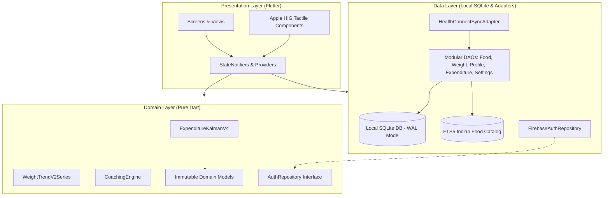
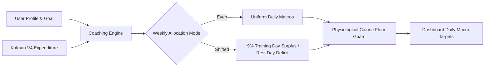

# Sique • Adaptive Metabolic Intelligence & Sovereign Nutrition Engine

<div align="center">


-2ea44f?style=for-the-badge&logo=githubactions&logoColor=white)


-orange?style=for-the-badge&logo=sqlite&logoColor=white)


<br/>

**Sique is an original, adherence-neutral nutritional coaching platform and metabolic expenditure tracker for Android and iOS. Built with clean architecture, Obsidian OLED dark design, a 2D joint-state Kalman expenditure filter ($W_t, E_t$), zero-phase bidirectional weight smoothing, dynamic 7-day caloric shifting, Google Health Connect smart scale synchronization, and a curated 500+ Indian food catalog with cooking oil adjustment modifiers.**

<br/>

[📥 **Download Latest Release (v2.0.0 APK)**](https://github.com/h4rysh/macrofactor-flutter/releases/latest) • [📖 **Algorithmic Specs**](docs/ALGORITHMS.md) • [🏛️ **Architecture Specs**](docs/ARCHITECTURE.md) • [🔒 **Privacy Statement**](docs/PRIVACY.md)

</div>

---

## 📑 Table of Contents
- [✨ Core Innovations](#-core-innovations)
- [🧠 The Sique Philosophy: Adherence-Neutral Nutrition](#-the-sique-philosophy-adherence-neutral-nutrition)
- [🏛️ System Architecture & Data Flow](#️-system-architecture--data-flow)
- [📈 Joint-State Kalman Expenditure Filter V4](#-joint-state-kalman-expenditure-filter-v4)
- [⚖️ Dual-Pass Weight Trend Smoothing V2](#️-dual-pass-weight-trend-smoothing-v2)
- [🎯 Dynamic Coaching Engine & 7-Day Shifting](#-dynamic-coaching-engine--7-day-shifting)
- [📱 23-Step Ethical & Clinical Onboarding](#-23-step-ethical--clinical-onboarding)
- [🍛 Curated 500+ Indian Food Catalog & Oil Modifiers](#-curated-500-indian-food-catalog--oil-modifiers)
- [🔒 100% On-Device Data Sovereignty](#-100-on-device-data-sovereignty)
- [🚀 Quickstart & Local Setup](#-quickstart--local-setup)
- [🧪 Comprehensive Test Suite](#-comprehensive-test-suite)
- [📦 Production Build & Release Artifacts](#-production-build--release-artifacts)
- [📂 Codebase Layout](#-codebase-layout)
- [📜 License & Contributing](#-license--contributing)

---

## ✨ Core Innovations

| Dimension | Architectural Implementation |
|---|---|
| **🧠 Metabolic Intelligence** | **Joint-State Kalman Filter V4** estimating true trend weight ($W_t$) and energy expenditure ($E_t$) with Huber $3\sigma$ innovation clipping and 14-day rolling mean intake imputation. |
| **⚖️ Dynamic Weight Smoothing** | **Dual-Pass EWMA (Causal + Zero-Phase Backward)** with dynamic $\Delta t$ scaling and median absolute deviation biological noise envelopes. |
| **🎯 Dynamic Coaching** | **Adherence-Neutral 7-Day Shifting**: 5 nutritional styles (Balanced, Low Fat, Low Carb, Keto, High Protein), Even vs Shifted workout day allocation, and instant target propagation without restart. |
| **📱 Clinical Onboarding** | **23-Step Modular Wizard** with clinical safety guardrails: Age $\ge 18$ validation lock and BMI $\ge 18.5$ aggressive deficit warning. |
| **🍛 Indian Nutrition Catalog** | **514 Curated Indian Staple Foods** with 887 authentic regional portion units (*katori*, *roti*, *ladle*, *cups*), sub-millisecond SQLite FTS5 search, and 1-tap cooking oil modifiers (+½ tsp, +1 tsp, +1 tbsp). |
| **🔒 Data Sovereignty** | **100% On-Device SQLite**: All dietary records, body weights, and metabolic states stay strictly local. Zero personal health data transmitted off-device. Instant one-tap total local data wipe. |
| **🔄 Hardware Synchronization** | **Google Health Connect Bidirectional Sync**: Multi-reading same-day arithmetic averaging, local timezone date grouping (`.toLocal()`), and manual entry conflict protection. |
| **🎨 Apple HIG UI Design** | **Obsidian OLED Dark Theme** (`#0B0B0E`), frosted liquid glass docks (`BackdropFilter` gaussian blur), tactile `AppleBouncy` feedback, and numerical odometer animations. |

---

## 🧠 The Sique Philosophy: Adherence-Neutral Nutrition

Traditional diet applications punish users when they deviate from their daily target calories through red warning banners, negative reinforcement, or arbitrary calorie penalties. 

**Sique fundamentally rejects punitive nutrition.**

Human metabolism behaves as an open thermodynamic system governed by the first law of thermodynamics:

$$\Delta \text{Energy Stored} = \text{Energy Intake} - \text{Energy Expenditure}$$

Whether you consume 1,200 or 4,500 kcal on a given day, Sique does not judge. It mathematically analyzes the relationship between logged intake and weight trend observations over time to calculate your true underlying metabolic rate. Sique empowers you with uncompromised, objective clarity.

---

## 🏛️ System Architecture & Data Flow

Sique strictly adheres to **Clean Architecture** with unidirectional data flow orchestrated via **Flutter Riverpod**:



---

## 📈 Joint-State Kalman Expenditure Filter V4

Sique models human metabolic adaptation using a discrete-time 2D joint-state Kalman filter (`lib/domain/algorithms/expenditure_kalman_v4.dart`):

### 1. State Vector
$$\mathbf{x}_t = \begin{bmatrix} W_t \\ E_t \end{bmatrix}$$
Where:
- $W_t$ is the true underlying body weight in kilograms.
- $E_t$ is daily Total Daily Energy Expenditure (TDEE) in kcal/day.

### 2. State Transition Matrix
$$\begin{bmatrix} W_{t+1} \\ E_{t+1} \end{bmatrix} = \begin{bmatrix} 1 & -\frac{\Delta t}{7700} \\ 0 & 1 \end{bmatrix} \begin{bmatrix} W_t \\ E_t \end{bmatrix} + \begin{bmatrix} \frac{\Delta t \cdot I_t}{7700} \\ 0 \end{bmatrix} + \mathbf{w}_t$$
Where:
- $I_t$ is caloric energy intake (kcal/day).
- $7700\text{ kcal/kg}$ represents the human tissue energy density constant.
- Process noise covariance:
  $$Q = \begin{bmatrix} Q_W & 0 \\ 0 & Q_E \end{bmatrix} = \begin{bmatrix} 0.04^2 & 0 \\ 0 & 10.0^2 \end{bmatrix}$$

### 3. Huber-Clipped Innovation Variance
When a scale weight observation $z_t$ is recorded:
$$y_t = z_t - H \hat{\mathbf{x}}_{t|t-1}, \quad H = \begin{bmatrix} 1 & 0 \end{bmatrix}$$
$$S_t = H P_{t|t-1} H^T + R, \quad R = 0.6^2\text{ kg}^2$$

To prevent acute water shocks (e.g. sodium retention, carb glycogen refeeding) from skewing expenditure estimates, innovation $y_t$ is Huber-clipped at $3\sigma = 3\sqrt{S_t}$:
$$\tilde{y}_t = \text{clamp}\left(y_t, -3\sqrt{S_t}, 3\sqrt{S_t}\right)$$

### 4. Unlogged Day Imputation & Regularity Guard
- **Missing Intake Imputation**: If intake $I_t$ is unlogged, Sique imputes from the trailing 14-day rolling mean intake $\bar{I}_{14}$ with augmented process noise $((0.15 \times \bar{I}_{14})/7700)^2$.
- **Regularity Guard**: If $>3$ of the trailing 7 days lack logs, metabolic updates automatically pause to prevent variance drift until logging resumes.

---

## ⚖️ Dual-Pass Weight Trend Smoothing V2

Scale weight exhibits up to $\pm 2.5\text{ kg}$ of biological noise caused by acute fluid retention. Sique applies a dual-pass EWMA smoothing pipeline (`lib/domain/algorithms/weight_trend_v2.dart`):

1. **Dynamic Interval Scaling**:
   $$\alpha(\Delta t) = 1 - (1 - \alpha_0)^{\Delta t}, \quad \alpha_0 = 0.10 \text{ (nominal half-life } \approx 6.5 \text{ days)}$$
2. **Causal Forward Pass**:
   $$EMA_t^{\text{fwd}} = \alpha \cdot w_t + (1 - \alpha) \cdot EMA_{t-1}^{\text{fwd}}$$
3. **Zero-Phase Backward Pass**:
   $$EMA_t^{\text{bwd}} = \alpha \cdot w_t + (1 - \alpha) \cdot EMA_{t+1}^{\text{bwd}}$$
   $$\text{Trend}_t = \frac{1}{2} \left( EMA_t^{\text{fwd}} + EMA_t^{\text{bwd}} \right)$$
4. **Biological Noise Envelope (Median Absolute Deviation)**:
   $$\text{Residual}_t = |w_t - \text{Trend}_t|, \quad \text{MAD}_t = \text{median}(\text{Residual}_{t-k \dots t})$$
   $$\text{Envelope}_t = \text{Trend}_t \pm 2.5 \cdot \text{MAD}_t$$

---

## 🎯 Dynamic Coaching Engine & 7-Day Shifting

Sique generates a 7-day macronutrient prescription (`lib/domain/algorithms/coaching_engine.dart`) based on your energy expenditure and target rate of change:



- **5 Nutritional Styles**: Balanced, Low Fat, Low Carb, Ketogenic, High Protein.
- **Strict Energy Conservation**:
  $$\sum_{d=1}^{7} \text{Calories}_d = 7 \times \text{DailyAverageCalories}$$
- **Physiological Calorie Floor**: Enforces minimum daily caloric safety bounds across all shifted days.
- **Instant Reactivity**: Changing target rate, goal type, or protein preferences immediately re-renders the dashboard rings without application restart.

---

## 📱 23-Step Ethical & Clinical Onboarding

Sique's onboarding flow (`lib/presentation/screens/onboarding/`) guides users through 23 modular, clinical-grade assessment steps:

```
Step 1–12: Basics & Biometrics
  ├── Health Connect sync authorization
  ├── Biological sex, DOB (Age ≥ 18 mandatory lock)
  ├── Height, Current Weight, Weight History
  ├── Body fat estimate & training experience
  └── Baseline Expenditure Estimate (Mifflin-St Jeor formula breakdown)

Step 13–16: Goal Direction
  ├── Goal Type (Lose, Maintain, Gain)
  ├── Target Weight (BMI ≥ 18.5 clinical deficit lock)
  └── Rate of Change & Summary

Step 17–23: Program Architecture
  ├── Diet Style & Calorie Floor selection
  ├── Calorie Distribution (Even vs Shifted Workout Days)
  ├── Protein Preference & Medical Disclaimer acknowledgement
  └── Active Program Activation -> Enter Dashboard
```

---

## 🍛 Curated 500+ Indian Food Catalog & Oil Modifiers

Sique features an authentic, offline Indian staple nutrition database (`assets/data/indian_food_catalog.json`):

- **514 Curated Indian Foods**: Sourced with ICMR-NIN Indian Food Composition Tables (IFCT) nutritional grounding.
- **887 Regional Portion Units**: Native serving metrics including *katori*, *roti*, *ladle*, *cups*, *pieces*, and grams.
- **SQLite FTS5 Full-Text Search**: Sub-millisecond offline query execution with prefix matching and operator escaping.
- **1-Tap Cooking Oil Modifiers**: Adjust nutrition for preparation methods with linear scaling and non-negative clamping:
  - Low Oil: $-50\text{ kcal}$
  - Standard Preparation: Baseline
  - $+½\text{ tsp Oil/Ghee}$: $+22\text{ kcal}, +2.5\text{g fat}$
  - $+1\text{ tsp Oil/Ghee}$: $+45\text{ kcal}, +5.0\text{g fat}$
  - $+1\text{ tbsp Oil/Ghee}$: $+135\text{ kcal}, +15.0\text{g fat}$

---

## 🔒 100% On-Device Data Sovereignty

Sique treats privacy as an absolute right, not an afterthought:

1. **Local-First SQLite Database**: All meal logs, scale weights, and profile configurations are persisted in local SQLite with Write-Ahead Logging (WAL) and foreign key constraints.
2. **Zero Health Data in Cloud**: Personal health logs, body weights, and metabolic history are **never** synced to external cloud databases.
3. **Provider-Aware Identity**: Authentication operations utilize standard Google Sign-In and Firebase Authentication isolated behind an abstract `AuthRepository`.
4. **Complete Local Erasure**: Triggering "Delete Account / Wipe All Data" resets all user tables (`food_logs`, `weight_logs`, `coaching_programs`, `day_completions`, `user_account_session`, `app_settings`), resets `sqlite_sequence`, wipes `SharedPreferences`, and invalidates in-memory state. The food catalog is preserved for immediate guest access.

---

## 🚀 Quickstart & Local Setup

### Prerequisites
- **Flutter SDK**: `^3.29.0`
- **Dart SDK**: `^3.7.0`
- **Java**: JDK 17
- **Android SDK**: API Level 34 (Minimum supported: API 26)

### Installation
```bash
# Clone the repository
git clone https://github.com/h4rysh/macrofactor-flutter.git
cd macrofactor-flutter

# Install Flutter dependencies
flutter pub get

# Run static code analysis
flutter analyze

# Execute test suite
flutter test

# Run application on a connected device or emulator
flutter run
```

---

## 🧪 Comprehensive Test Suite

Sique is hardened with **577 automated tests** across unit, widget, simulation, and adversarial stress suites:

```bash
# Run all tests
flutter test

# Run Kalman V4 Monte Carlo simulation benchmarks (100 runs per scenario)
flutter test test/algorithms/expenditure_kalman_simulation_test.dart

# Run database migration & typed exception resilience tests
flutter test test/data/database_resilience_test.dart

# Run end-to-end user journeys
flutter test test/presentation/e2e_user_journey_test.dart
```

### 8 Canonical Monte Carlo Simulation Benchmarks
1. **Steady State Jitter**: 70 days steady 2,500 kcal intake ($\text{jitter} < 12.0\text{ kcal/day}$).
2. **Deficit Weight Loss**: $-0.45\text{ kg/wk}$ & $-0.9\text{ kg/wk}$ (error within $\pm 60\text{ kcal}$).
3. **Surplus Weight Gain**: $+0.45\text{ kg/wk}$ (error within $\pm 60\text{ kcal}$).
4. **Sparse Weigh-Ins**: Weigh-ins every 3 and 7 days ($\text{error} < 80.0\text{ kcal}$).
5. **30% Missing Intake Logs**: 30% unlogged days with mean imputation ($\text{error} < 60.0\text{ kcal}$).
6. **Biological Fluid Shock**: $+1.5\text{ kg}$ decaying over 6 days ($\text{peak deviation} < 250.0\text{ kcal}$).
7. **Step Response**: $+200\text{ kcal}$ metabolic step converges within 30 days without overshoot.
8. **Temporal Causality**: Adding future observations preserves historical estimates ($0.0000\text{ kcal}$ divergence).

---

## 📦 Production Build & Release Artifacts

To generate an optimized release APK:
```bash
flutter build apk --release
```

Release artifact location:
`build/app/outputs/flutter-apk/app-release.apk` (75.0 MB)

Verify SHA-256 Checksum:
```bash
shasum -a 256 build/app/outputs/flutter-apk/app-release.apk
# 82d1eac2a9d5311233e05e4086a4a3fb08f4cccea87fa78824317975ad59cea3
```

---

## 📂 Codebase Layout

```
lib/
 ├── data/
 │    ├── local/               # AppDatabase, DatabaseSchema, Migrations
 │    │    └── dao/            # Modular DAOs (FoodDao, WeightDao, ProfileDao, etc.)
 │    ├── repositories/        # FirebaseAuthRepository, FakeAuthRepository
 │    └── sync/                # HealthConnectSyncAdapter
 ├── domain/
 │    ├── algorithms/          # Pure Dart: ExpenditureKalmanV4, WeightTrendV2, CoachingEngine
 │    ├── models/              # Immutable domain entities
 │    └── repositories/        # Repository abstract contracts
 └── presentation/
      ├── dialogs/             # PortionSelectorDialog, DeleteAccountDialog, etc.
      ├── observers/           # AppLifecycleSyncObserver (foreground rollover)
      ├── providers/           # Riverpod StateNotifiers & reactive providers
      ├── screens/
      │    ├── onboarding/     # 23 Modular Onboarding Step Screens (<350 lines each)
      │    └── auth/           # EmailAuthDialog, ChangePasswordDialog
      ├── theme/               # Obsidian dark theme tokens & color semantics
      └── widgets/             # Apple HIG widgets (AppleTactileCard, AppleBouncy, AuthLegalFooter)
```

---

## 📜 License & Contributing

- **License**: MIT License — see [LICENSE](LICENSE) for details.
- **Contributing**: Please review [CONTRIBUTING.md](CONTRIBUTING.md) and [CODE_OF_CONDUCT.md](CODE_OF_CONDUCT.md) before opening pull requests.
- **Security**: For vulnerability disclosure and security policies, see [SECURITY.md](SECURITY.md).
- **Changelog**: Detailed release notes available in [CHANGELOG.md](CHANGELOG.md).
