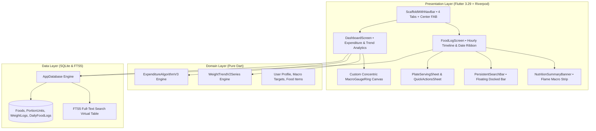

# MacroFactor (Indian Edition) • 1:1 Clean-Room Flutter Reconstruction

<div align="center">


<br/>

**A clean-room 1:1 visual & UX reconstruction of MacroFactor for Android & iOS, featuring authentic Obsidian dark UI, hourly timeline logging, adherence-neutral Bayesian metabolic expenditure algorithms, and a 2,500+ Indian food database (ICMR-NIN IFCT) with 1-tap cooking oil modifiers.**

<br/>

[📥 **Download Production APK (v1.1.0)**](https://github.com/h4rysh/macrofactor-flutter/releases/download/v1.1.0/app-release.apk) • [🏛️ **Architecture Spec**](docs/ARCHITECTURE.md) • [📐 **Algorithm Formulations**](docs/ALGORITHMS.md)

</div>

---

## 📱 Visual & UX Reconstruction (REA Clean-Room)

Engineered through systematic clean-room reverse engineering analysis of the authentic application topology, design tokens, and user experience patterns:

```
Obsidian Base:     #0B0B0E  (True deep OLED dark)
Elevated Cards:    #16161C  (Subtle elevated surface)
Hairline Borders:  #26262E  (1px micro-dividers)
Macro Accents:     🔥 #FF5722 Cal  •  🍗 #FB923C Protein  •  🥑 #FACC15 Fat  •  🌾 #38BDF8 Carbs  •  ⚡ #0055E1 Expenditure
```

### Authentic Core Components
- ⏱️ **Boot to Food Log**: Default startup launches directly into the hourly food timeline (Index 1), matching daily workflow.
- 📅 **7-Day Date Ribbon**: Interactive horizontal date ribbon showing day abbreviations, numerical dates, today indicator, and completion status pips.
- 🔥 **Flame & Macro Nutrition Strip**: Sleek horizontal status strip featuring flame icon, remaining calories, macro targets with color underlines, and page dot indicators.
- 🕒 **Hourly Timeline Slots**: `[ 8 AM | + ]` capsule buttons for rapid hourly food entry, collapsed food icon rows, and detailed meal breakdown cards.
- 🍽️ **Plate Serving Bottom Sheet**: Interactive serving size adjustor with real-time macro calculation, instant portion multipliers, and log confirmation.
- 🔍 **Floating Docked Action Bar**: Persistent floating search bar docked above bottom nav with instant search, barcode scanner trigger, and quick-add actions (`+` bottom sheet).
- 🧭 **Authentic 4-Tab Bottom Navigation**: Dashboard, Food Log, Strategy (3-node hub icon), and More, anchored by the elevated circular action button.

---

## 🧠 Philosophy: Adherence-Neutral Nutrition

Traditional nutrition applications punish the user with bright red "over-budget" rings, guilt-inducing alerts, and arbitrary calorie deductions. When life happens and a meal is over-eaten, traditional apps ask you to starve the next day—perpetuating the restrict-binge cycle.

**MacroFactor does not judge. MacroFactor calculates.**

```
Traditional Apps:      Calories Consumed > Target  ➜  Red Shame Screen  ➜  Cut Next Day Calories
MacroFactor Engine:    Calories Consumed > Target  ➜  Observe Weight    ➜  Update Metabolic Model
```

Every day is treated as an **informative data observation**. If you ate 3,500 kcal and did not gain weight, the algorithm recognizes your metabolic expenditure is higher than anticipated and adjusts your targets **up**, not down.

| Attribute | Traditional Apps (MyFitnessPal, LoseIt) | MacroFactor (Indian Edition) |
|---|---|---|
| **Goal Deviations** | Red warning badges, deficit penalties | Adherence-neutral mathematical calibration |
| **Expenditure Model** | Static formula calculated once (Harris-Benedict) | **Dynamic Bayesian Kalman Filter** continuously adapting |
| **Scale Weight** | Raw noisy scale readings cause panic | **Bidirectional Zero-Phase EMA** with noise envelopes |
| **Indian Nutrition** | Crowdsourced, inaccurate generic entries | Verified **ICMR-NIN IFCT standards** with katori & piece portions |
| **Cooking Fat** | Unaccounted or manual tedious oil entry | **1-Tap Oil Modifier** (+½ tsp, +1 tsp, +1 tbsp) |

---

## ✨ Key Features

### 1. Dynamic Expenditure Engine (Kalman Filter V3)
- Models the human body as an energy balance dynamic system.
- Continuously calculates your **Total Daily Energy Expenditure (TDEE)** from daily caloric intake and change in trend weight.
- **$\pm 150\text{ kcal}$ Daily Flux Clamp**: Dampens measurement noise and prevents runaway targets caused by acute fluid retention.
- **Graceful Missing-Day Handling**: Up to 3 days of missing logs expand prior covariance without distorting mean; long breaks pause adjustments safely without penalizing the user.

### 2. Weight Trend Smoothing (EMA V2 + Noise Envelope)
- Isolates true tissue changes (fat and muscle) from erratic daily water fluctuations (glycogen replenishment, sodium, hydration).
- Bidirectional zero-phase smoothing eliminates phase lag.
- Bilateral biological noise envelope ($2.5\times$ rolling Median Absolute Deviation).
- Forward trajectory projection based on thermodynamic deficit ($7,700\text{ kcal/kg}$).

### 3. HealthifyMe-Grade Indian Food Database
- Embedded offline **SQLite FTS5 full-text search engine** containing **2,500+ Indian & Global food items**.
- Curated using the **National Institute of Nutrition (ICMR-NIN) Indian Food Composition Tables (IFCT)**.
- Authentic regional Indian cuisine representation:
  - **South Indian**: Dosa, Idli, Medu Vada, Sambar, Rasam, Pongal, Appam, Avial, Poriyal, Chettinad Chicken, Fish Curry.
  - **North Indian**: Paneer Butter Masala, Dal Makhani, Rajma, Chole, Palak Paneer, Roti, Naan, Paratha, Biryani, Pulao.
- Native portion units: *Katori (150 ml)*, *Roti / Chapati (count)*, *Dosa / Idli (piece)*, *Ladle (60 ml)*, *Grams*, *Cups*.

### 4. 1-Tap Cooking Oil Modifier
Home-cooked Indian meals frequently vary in oil and ghee usage. Instead of breaking down a dish into its raw ingredients every time you cook:
- Select any dish (e.g. *Bhindi Masala* or *Egg Curry*).
- Tap the **Oil Modifier**:
  - `No Extra Oil` (Base recipe)
  - `+½ tsp Oil / Ghee` (+22.5 kcal, +2.5g fat)
  - `+1 tsp Oil / Ghee` (+45.0 kcal, +5.0g fat)
  - `+1 tbsp Oil / Ghee` (+120.0 kcal, +14.0g fat)
- The nutrition aggregate updates instantaneously in memory.

---

## 📐 Mathematical Formulations

### A. Exponential Moving Average with Dynamic $\Delta t$ Interval Scaling
For consecutive scale weights $w_t$ sampled at non-uniform intervals $\Delta t$:

$$\alpha_{\text{scaled}} = 1 - (1 - \alpha_0)^{\Delta t}$$

$$\text{EMA}_t = \alpha_{\text{scaled}} \cdot w_t + (1 - \alpha_{\text{scaled}}) \cdot \text{EMA}_{t-1}$$

Zero-phase backward smoothing pass:

$$\text{Smoothed}_t = \frac{1}{2} \left( \text{EMA}_t^{\text{forward}} + \text{EMA}_t^{\text{backward}} \right)$$

### B. Bayesian Kalman State Estimation for TDEE
The latent state $x_k$ (Expenditure in kcal/day) is tracked through a transition and measurement model:

$$\text{Prior State}: \quad \hat{x}_{k|k-1} = \hat{x}_{k-1}$$

$$\text{Prior Covariance}: \quad P_{k|k-1} = P_{k-1} + Q_k$$

$$\text{Observed Expenditure}: \quad z_k = C_k - \kappa \cdot \Delta w_k \quad (\kappa = 7700\text{ kcal/kg})$$

$$\text{Kalman Gain}: \quad K_k = \frac{P_{k|k-1}}{P_{k|k-1} + R_k}$$

$$\text{Posterior Update}: \quad \hat{x}_k = \hat{x}_{k|k-1} + K_k (z_k - \hat{x}_{k|k-1})$$

$$\text{Flux Clamp}: \quad \Delta x_k = \text{clamp}(\hat{x}_k - \hat{x}_{k-1}, -150, +150)$$

---

## 🏛️ System Architecture



---

## 🧪 Verification & Quality Gate

Every build passes automated verification pipelines:

| Check | Tool | Result |
|---|---|---|
| **Static Code Analysis** | `flutter analyze` | **0 issues, 0 warnings** |
| **Unit & Algorithm Tests** | `flutter test` | **27 / 27 Passed (100%)** |
| **Code Formatting** | `dart format` | **Clean (80-char wrap)** |
| **Production Compilation** | `flutter build apk --release` | **Clean exit (code 0)** |
| **Binary Output** | `app-release.apk` | **76.5 MB (Universal Release APK)** |

---

## 🚀 Quick Start & Development

### Prerequisites
- [Flutter SDK](https://docs.flutter.dev/get-started/install) 3.29.0 or higher
- Android SDK 34 / Java 17

### 1. Clone & Install
```bash
git clone https://github.com/h4rysh/macrofactor-flutter.git
cd macrofactor-flutter
flutter pub get
```

### 2. Run Tests
```bash
# Run all 27 unit, algorithm, and widget tests
flutter test

# Run with code coverage
flutter test --coverage
```

### 3. Run on Device / Emulator
```bash
flutter run
```

### 4. Build Release APK
```bash
flutter build apk --release
```
The compiled binary will be placed at `build/app/outputs/flutter-apk/app-release.apk`.

---

## 📄 License

This project is licensed under the MIT License - see the [LICENSE](LICENSE) file for details.

---

<div align="center">
<sub>Crafted with clean-room precision, adherence-neutral science, and deep reverse engineering fidelity.</sub>
</div>
