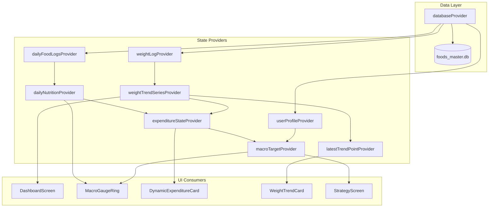

# Architecture & Data Flow Specification

## 1. Architectural Philosophy
The application follows strict **Clean Architecture** with unidirectional data flow powered by **Flutter Riverpod**:

```
Presentation (Widgets & Providers)
        │
        ▼
   Domain Layer (Pure Dart: Algorithms & Entities)
        ▲
        │
   Data Layer (Drift SQLite / FTS5 Full-Text Search)
```

### Layer Rules
1. **Domain Layer (`lib/domain/`)**:
   - Zero dependencies on Flutter UI (`package:flutter`) or persistence packages.
   - Houses the core mathematical engines: `WeightTrendV2Series` and `ExpenditureAlgorithmV3`.
   - Immutable data models (`ScaleWeightEntry`, `WeightTrendPoint`, `ExpenditureState`, `DailyEnergyObservation`, `MacroTargets`).
2. **Data Layer (`lib/data/`)**:
   - Manages SQLite persistence, schema migrations, and full-text search indices via `AppDatabase`.
   - Embeds the ICMR-NIN IFCT dataset and USDA food master table.
   - Translates raw SQL rows into typed domain entities.
3. **Presentation Layer (`lib/presentation/`)**:
   - Composed of decoupled widgets, Riverpod state notifiers, and design tokens (`AppTheme`).
   - Consumer widgets react to state changes without triggering redundant repaints.

---

## 2. State Management Topology (Riverpod)



---

## 3. Database Schema Design

The SQLite database (`foods_master.db`) implements virtual FTS5 indices for sub-millisecond food queries:

### Virtual Table: `foods_fts`
```sql
CREATE VIRTUAL TABLE foods_fts USING fts5(
    name,
    category,
    region,
    cuisine,
    aliases,
    content='foods',
    content_rowid='id'
);
```

### Table: `portion_units`
Maps natural portion sizes to gram weight multipliers:
```sql
CREATE TABLE portion_units (
    id TEXT PRIMARY KEY,
    food_id TEXT NOT NULL,
    unit_name TEXT NOT NULL,
    grams_per_unit REAL NOT NULL,
    FOREIGN KEY(food_id) REFERENCES foods(id) ON DELETE CASCADE
);
```

---

## 4. UI Design System Tokens
- **Surface**: `#121620` (Pitch background for OLED screens)
- **Cards**: `#1A1F2C` (Primary card surface)
- **Elevated Cards**: `#222736`
- **Border**: `#2D3548`
- **Text Primary**: `#FFFFFF`
- **Text Secondary**: `#9CA3AF`
- **Calories Accent**: `#FF6B00`
- **Protein Accent**: `#FF4D6D`
- **Carbs Accent**: `#4361EE`
- **Fat Accent**: `#F72585`
- **Trend Weight Accent**: `#00F5D4`
