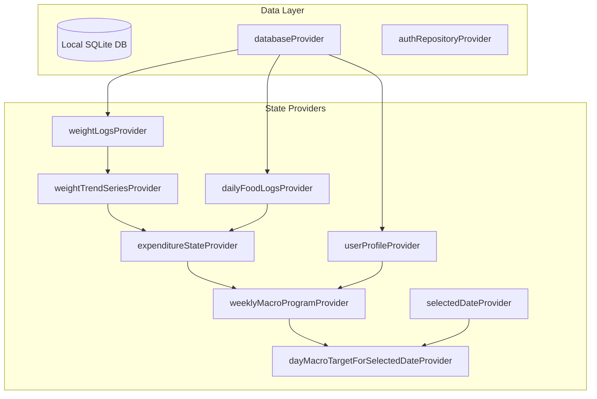

# Sique Architecture & Data Flow Specification

## 1. Architectural Philosophy
Sique follows strict **Clean Architecture** with unidirectional data flow powered by **Flutter Riverpod**:

```
Presentation Layer (Widgets, Screens & StateNotifier Providers)
        │
        ▼
   Domain Layer (Pure Dart: Algorithms, Models & Interfaces)
        ▲
        │
   Data Layer (SQLite Storage, DAOs, Services & Adapters)
```

### Layer Rules
1. **Domain Layer (`lib/domain/`)**:
   - Zero dependencies on Flutter UI (`package:flutter`) or persistence packages.
   - Houses mathematical engines: `WeightTrendV2Series`, `ExpenditureKalmanV4`, and `CoachingEngine`.
   - Immutable data models (`ScaleWeightEntry`, `WeightTrendPoint`, `ExpenditureState`, `WeeklyMacroProgram`).
   - Repository interfaces (`AuthRepository`).
2. **Data Layer (`lib/data/`)**:
   - Manages SQLite persistence, schema definitions, and full-text search indices via modular DAOs.
   - Adapters for external sensors (`HealthConnectSyncAdapter`).
   - Translates raw SQL rows into typed domain entities.
3. **Presentation Layer (`lib/presentation/`)**:
   - Composed of decoupled widgets, Riverpod state notifiers, and design tokens (`AppTheme`).
   - Consumer widgets react to state changes without triggering redundant repaints.

---

## 2. State Management Topology (Riverpod)



---

## 3. Storage & Privacy Guarantees
- All food records, scale weights, and profile settings are stored strictly in local SQLite.
- External cloud synchronization of health records is deliberately excluded.
- Authentication utilizes Firebase Authentication via the abstract `AuthRepository`.
