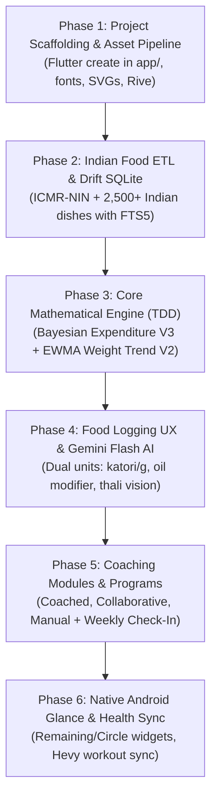

# MacroFactor Clean-Room Reconstruction & Indian Food Integration Plan

> **Architectural Status**: Fully Aligned via `/grill-me` Design Consensus  
> **Target Package**: `com.sbs.diet` (MacroFactor v5.8.9)  
> **Design Strategy**: Strict 1:1 MacroFactor Algorithmic & Coaching Fidelity + High-Density North/South Indian Food Database (HealthifyMe-grade)  
> **Tech Stack**: Flutter 3.47+ (Dart 3.13+), Riverpod 2.x, Drift SQLite with FTS5, Google Gemini Flash Multimodal, Kotlin Jetpack Glance, Health Connect / Apple Health sync.

---

## 1. Agreed Architecture Matrix

| Decision Domain | Selected Architecture & Specification |
|---|---|
| **1. Food Database** | **Hybrid Tiered Database**: Bundled local SQLite (`foods_master.db`) with ICMR-NIN IFCT raw foods + 2,500+ North & South Indian cooked dishes with calibrated units, falling back to Open Food Facts India & USDA for packaged barcodes. |
| **2. Food Logging UX** | **Smart Dual-Unit Selector with Oil Modifier**: Visual Indian household units (small/med/large katori, phulka, piece, ladle) with 1-tap toggle to exact grams, plus a 1-tap oil/tadka modifier (Homestyle low oil, Standard, Restaurant / Desi Ghee). |
| **3. Multimodal AI Logging** | **Multi-Item Decomposition via Gemini Flash**: Camera snap (thali/mixed curries) or voice input (English/Hindi/regional) decomposed into discrete items mapped to local DB with estimated katori/gram portions in an editable 1-tap review sheet. |
| **4. Coaching & Analytics** | **Strict 1:1 MacroFactor Fidelity**: Exact 3 programs (Coached, Collaborative, Manual), `ExpenditureAlgorithmV3` (adaptive Bayesian state-space tracker, logging gap resilience), and `WeightTrendV2Series` (bidirectional smoothing + water-weight noise envelopes). |
| **5. State & Persistence** | **Riverpod 2.x + Drift SQLite**: Reactive code-gen providers with Drift for compile-time verified relational queries, reactive streams, and 100% offline-first speed. |
| **6. Design System & Assets** | **Extended Hybrid Aesthetic**: MacroFactor dark neon/light theme, `MacroSans` typography, 450 vector food SVGs, 18 Rive animations, and expanded `icon_metadata.jsonl` with Indian dish tokens (biryani, roti, dosa, idli, dal, paneer). |
| **7. Workout / Fitness Scope** | **Health Connect / HealthKit Passive Sync**: Nutrition, weight trends, and expenditure focus. Passive sync with Hevy (and other trackers) for workouts, active calories, and steps via Health Connect / Apple Health. |
| **8. Native Android Platform** | **Core Jetpack Glance Widgets + Dynamic Icons**: Kotlin Glance widgets (`Remaining` budget & `Circle` calorie/expenditure ring) and dynamic launcher icon switching via platform channels. |
| **9. Indian Food Ingestion** | **Automated ETL Pipeline**: Deterministic script compiling ICMR-NIN IFCT whole foods + 2,500+ cooked North & South Indian recipes into an FTS5-indexed SQLite database bundled in the app. |
| **10. Project Structure** | **Clean Monorepo**: Flutter project in `app/` (`macro_factor_app`), data pipelines in `scripts/`, extracted assets in `extracted_assets/`, reverse engineering proof in `target_apk/`. |

---

## 2. Monorepo File System Layout

```
MF REA/
├── app/                                 # Clean-room Flutter Application (macro_factor_app)
│   ├── android/
│   │   └── app/src/main/kotlin/com/antigravity/macrofactor/
│   │       ├── MainActivity.kt          # MethodChannel bridge for icons & widgets
│   │       ├── glance/                  # Kotlin Jetpack Glance AppWidgets
│   │       │   ├── RemainingWidget.kt   # Daily remaining calorie/macro budget
│   │       │   └── CircleWidget.kt      # Calorie intake & expenditure ring
│   │       └── health/                  # Health Connect manager (workouts & steps)
│   ├── assets/
│   │   ├── animations/                  # 18 Rive interactive animations
│   │   ├── database/                    # foods_master.db (Pre-compiled SQLite)
│   │   ├── foods/                       # 450 vector SVG illustrations
│   │   ├── fonts/                       # 15 TTF fonts (MacroSans-VF, DMSans, Inter)
│   │   └── metadata/                    # icon_metadata.jsonl (406+ Indian matching rules)
│   ├── lib/
│   │   ├── core/                        # Theme, typography, constants, extensions
│   │   ├── data/
│   │   │   ├── local/                   # Drift SQLite database, DAOs, converters
│   │   │   ├── remote/                  # Open Food Facts API & Gemini Flash client
│   │   │   └── repositories/            # Food, Log, Expenditure, and Health repositories
│   │   ├── domain/
│   │   │   ├── algorithms/              # ExpenditureAlgorithmV3, WeightTrendV2Series
│   │   │   ├── coaching/                # Coached, Collaborative, Manual programs
│   │   │   └── models/                  # FoodItem, ServingUnit, DailyLog, Expenditure
│   │   └── presentation/                # Screens, Riverpod providers, UI widgets
│   └── pubspec.yaml
├── extracted_assets/                    # Extracted vector SVGs, fonts, and Rive binaries
├── scripts/                             # Python / Node.js ETL compilation pipelines
│   ├── build_indian_food_db.py          # Merges ICMR-NIN + Indian dishes into foods_master.db
│   └── test_expenditure_vectors.py      # Verification test suite for Bayesian expenditure
└── target_apk/                          # Reverse engineering APK splits & session evidence
```

---

## 3. Step-by-Step Implementation Roadmap



### Phase 1: Project Scaffolding & Asset Pipeline
1. Run `flutter create --org com.antigravity --project-name macro_factor_app app`.
2. Configure `pubspec.yaml` with core dependencies from `NOTICES.Z`:
   - `flutter_riverpod`, `riverpod_annotation`, `drift`, `sqlite3_flutter_libs`, `rive`, `flutter_svg`, `google_generative_ai`, `health`.
3. Register the 11 font families (`MacroSans-VF.ttf`, `DMSans`, `Inter`) in `pubspec.yaml`.
4. Copy the 450 vector food illustrations (`.svg`) and 18 Rive files into `app/assets/`.
5. Expand `icon_metadata.jsonl` with Indian food keyword mappings.

### Phase 2: Indian Food ETL & Drift SQLite Engine
1. Create `scripts/build_indian_food_db.py`:
   - Parse ICMR-NIN IFCT tables for raw ingredients (whole grains, pulses, spices, vegetables).
   - Ingest 2,500+ North & South Indian cooked dishes with calibrated portion units (katoris, rotis, pieces, ladles).
   - Generate FTS5 virtual table for lightning-fast full-text search with phonetic/transliterated aliases.
2. Build Drift tables: `FoodsTable`, `PortionUnitsTable`, `FoodLogsTable`, `ScaleWeightsTable`, `ExpenditureSnapshotsTable`.
3. Implement `FoodRepository` with local 0ms search + Open Food Facts remote fallback.

### Phase 3: Core Mathematical Engine (TDD)
1. Write unit tests against known MacroFactor test vectors:
   - `WeightTrendV2Series`: Unidirectional EMA-9 + Bidirectional forward-backward filter + biological noise envelope (`WeightTrendNoiseRangePoint`).
   - `ExpenditureAlgorithmV3`: Bayesian state-space tracker, flux damping ($\le 150\text{ kcal}$ adaptive window), 3-day missing log resilience, and pause/resume lifecycle.
2. Verify with 100% test coverage using `flutter test`.

### Phase 4: Food Logging UX & Multimodal Gemini Flash AI
1. Build `FoodSearchScreen` with instant debounced FTS5 search and vector icon rendering.
2. Build `FoodDetailModal` with:
   - Visual Indian portion picker (e.g. Small / Med / Large Katori, Roti count, grams).
   - 1-tap Oil / Preparation modifier (Low oil, Standard, Desi Ghee).
3. Implement `GeminiFoodService` using `google_generative_ai`:
   - Decomposes thali/plate images or voice recordings into discrete items with portion estimates.
   - Opens multi-item bottom sheet for instant user review.

### Phase 5: Coaching Modules & Program System
1. Implement the 3 coaching programs:
   - **Coached**: Weekly automated macro adjustments targeting user-defined rate of change.
   - **Collaborative**: Expenditure-derived daily calorie budget with user-controlled weekly calorie distribution (e.g. higher weekend calories).
   - **Manual**: User-specified macros with passive expenditure tracking.
2. Implement weekly check-in flow (`program_update_module`).

### Phase 6: Android Native Glance Widgets & Hevy / Health Sync
1. Configure Android Health Connect / iOS HealthKit to passively ingest workouts, active energy, and steps (logged by Hevy).
2. Implement Kotlin Jetpack Glance AppWidgets:
   - `RemainingWidget`: Live remaining calorie/protein/fat/carb budget.
   - `CircleWidget`: Interactive expenditure & calorie ring gauge.
3. Add `MainActivityAlias` for dynamic launcher icons.
