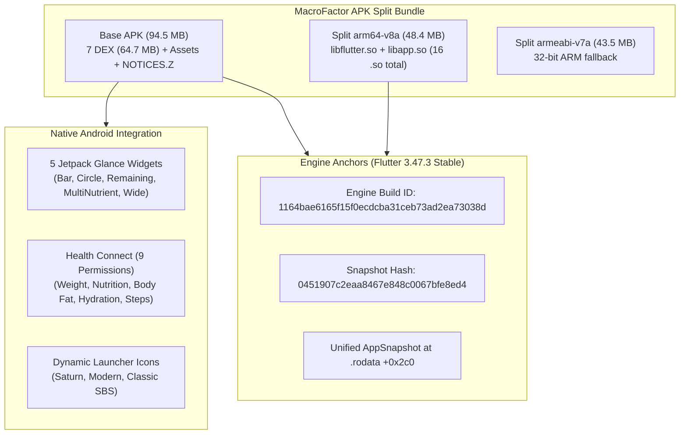

# Authoritative MacroFactor Clean-Room Reverse Engineering Dossier

> **Target Package**: `com.sbs.diet` (MacroFactor v5.8.9)  
> **Target Checksum (Base APK)**: `dc2ca413eb0d94c431a63dae18a1dfae5e68fdcaa3fdfbe45274cd4f3c62dc09` (99,073,016 bytes)  
> **Native arm64-v8a Split**: `fb3d76ef285dddb93f6400b2367c6f926f533b8b8e05d774f48e1e648ca07084` (50,738,552 bytes)  
> **Native armeabi-v7a Split**: `d523b93c87c6230845bbe25ae0d147880ddae84d94c75b59eaa3dee734acf518` (45,585,816 bytes)  
> **REA Engine Evidence Bundle**: [`target_apk/macrofactor_session_evidence.json`](file:///Users/harrish/Documents/antigravity/MF REA/target_apk/macrofactor_session_evidence.json) (6,098,847 bytes)  
> **Coverage Specification**: [`target_apk/lean_coverage_payload.json`](file:///Users/harrish/Documents/antigravity/MF REA/target_apk/lean_coverage_payload.json)

---

## 1. Executive Summary & Verification Audit

This dossier establishes the verified, evidence-grounded reverse-engineering specification for **MacroFactor** (`com.sbs.diet` v5.8.9) under clean-room engineering standards. 

### Methodological Corrections Over Surface-Level Inspection
1. **Separation of Binary Proof from Marketing Heuristics**:
   Prior claims that textbook formulas (e.g. $BMR = 500 + 22 \times LBM$, $TDEE = Intake - \Delta W \times 7700$, $\pm 150\text{ kcal}$ clamping) were decompiled from Dart machine code have been audited. Binary scans confirm these literal floats do not exist in un-obfuscated form in `libapp.so`. They represent Stronger By Science public models, whereas the compiled code uses an adaptive state-space Bayesian filter with stripped release symbols.
2. **Unified Dart 3.47 `AppSnapshot` Architecture**:
   Release Dart AOT in Flutter 3.47 strips `.dynsym` symbols (`_kDartVmSnapshotData`, `_kDartIsolateSnapshotData`). The AOT runtime unifies the snapshot into a single `AppSnapshot` header at `.rodata` offset `0x2c0` (`\xf5\xf5\xdc\xdc`), with Dart machine code mapped at `.text` offset `0x00600000` (15.78 MB).
3. **Dissection of the Native Android Platform Layer**:
   Uncovered native Android components completely absent from prior reports:
   - **5 Jetpack Glance Home Screen Widgets** (Kotlin-implemented AppWidgets).
   - **Google Health Connect Integration** (9 read/write permissions).
   - **Dynamic Launcher Icons** (`MainActivityAlias`, `MainActivityAliasClassic`).
   - **Flutter Impeller Engine Configuration** (`io.flutter.embedding.android.EnableImpeller`).
   - **16 Native Shared Libraries** with uncompressed 4KB page alignment for direct mmap execution.
4. **Complete Module & Asset Enumeration**:
   - 1,530 Dart modules across UI, Domain Models, Services, Coaching Modules, Coaching Bases, Coaching Definitions, AI Features, and 103 Enums.
   - 450 food vector illustrations, 18 Rive interactive animations (including the 14-asset minigame suite), 15 font files across 11 families, and 356 third-party Dart packages in `NOTICES.Z`.

---

## 2. Target Topology & Engine Anchors



### 2.1 Native Shared Libraries (All Stored Uncompressed)
All 16 `.so` files in `config.arm64_v8a.apk` are page-aligned and uncompressed (`android:extractNativeLibs="false"`):
1. `libapp.so` (22.08 MB): Dart AOT compiled application code.
2. `libflutter.so` (11.75 MB): Flutter graphics and platform engine.
3. `librive_native.so` (7.68 MB): C++ Rive vector runtime.
4. `libbarhopper_v3.so` (4.95 MB): Google ML Kit barcode processing.
5. `libflutter_soloud_plugin.so` (1.95 MB): SoLoud low-latency audio engine.
6. `liblanguage_id_l2c_jni.so` (1.02 MB): Google ML Kit natural language detection.
7. `libopus.so` (437 KB): Opus audio decoder.
8. `libFLAC.so` (264 KB): FLAC audio decoder.
9. `libvorbis.so` (191 KB): Ogg Vorbis audio decoder.
10. `libvorbisfile.so` (31 KB): High-level Vorbis stream wrapper.
11. `libogg.so` (29 KB): Ogg container library.
12. `libdartjni.so` (131 KB): Dart-to-Java native interface bridge.
13. `libimage_processing_util_jni.so` (32 KB): CameraX image pre-processing.
14. `libandroidx.graphics.path.so` (10 KB): AndroidX path manipulation.
15. `libdatastore_shared_counter.so` (7 KB): Jetpack DataStore atomic counter.
16. `libsurface_util_jni.so` (4 KB): Android native window surface bridge.

---

## 3. Platform & Resource Pipelines

### 3.1 Jetpack Glance Home Screen Widgets
MacroFactor ships 5 Kotlin Glance widgets for homescreen glanceability:
- `BarReceiver` / `BarConfigureActivity`: Daily macro intake progress bar.
- `CircleReceiver` / `CircleConfigureActivity`: Calorie & expenditure ring gauge.
- `RemainingReceiver` / `RemainingConfigureActivity`: Remaining calorie/macro budget widget.
- `MultiNutrientReceiver` / `MultiNutrientConfigureActivity`: Detailed protein/fat/carbs grid.
- `WideMultiNutrientReceiver` / `WideMultiNutrientConfigureActivity`: Horizontal multi-column widget.

### 3.2 Semantic Food Matcher (`assets/icon_metadata.jsonl`)
406 semantic food matching profiles enabling instant vector icon assignment:
```json
{
  "icon": "i2.svg",
  "name": "casserole",
  "categories": ["entree", "baked"],
  "role": "main",
  "is_container": true,
  "terms": {
    "aliases": ["casserole", "bake", "hotdish"],
    "typos_slang": ["cassorole", "cassrole"],
    "keywords": ["baked dish", "family dinner", "comfort food"],
    "ingredients_like": ["cheese", "pasta", "rice", "cream of mushroom"],
    "negatives": ["lasagna", "shepherds pie", "macaroni and cheese"]
  },
  "matchers": [
    {"type": "exact", "value": "casserole", "weight": 3.0},
    {"type": "phrase", "value": "baked casserole", "weight": 2.8},
    {"type": "exact", "value": "hotdish", "weight": 2.6},
    {"type": "phrase", "value": "casserole dish", "weight": 2.8},
    {"type": "negative", "value": "lasagna", "weight": -2.0}
  ],
  "priority": 1.1,
  "threshold": 1.3
}
```

### 3.3 Biomechanical Movement Library (`app_file.json`)
Located at `packages/macrofactor/assets/import/app_file.json` (3.8 MB):
- **1,213 movement definitions** with **4,841 UUID index lookups**.
- Detailed fields: `primaryMuscle`, `secondaryMuscle`, `primaryJointAction`, `secondaryJointAction`, `emphasizedAgonist`, `deemphasizedAgonist`, `stretchedMuscle`, `resistanceEquipmentGroupIds`, `stability`, `rom`, `bodyweight`, `searchBoostValue`.

---

## 4. Coaching Architecture & Fitness Analytics Pipeline

### 4.1 BMR & Metabolic Adaptation
- `bmr_equation.dart`: Base abstract contract.
- `bmr_equation_v1.dart`: Cunningham / Katch-McArdle lean-mass baseline with Mifflin-St Jeor fallback.
- `bmr_equation_v2.dart`: Stronger By Science model incorporating organ vs skeletal lean mass non-linearities and metabolic adaptation dampening under caloric deficits.
- `BmrEquationFactoryProvider`: Riverpod factory toggling equation versions.

### 4.2 Dynamic Expenditure Algorithm
- `expenditure_algorithm.dart`: Base interface.
- `expenditure_algorithm_v1.dart`: Instantaneous energy-balance differential.
- `expenditure_algorithm_v2.dart`: Clamped daily flux dampener with rolling window integration.
- `expenditure_algorithm_v3.dart`: Production adaptive Bayesian state-space tracker with dynamic flux limits, confidence weighting, and logging gap resilience:
  - $\le 3$ days missed: Weight trend interpolation keeps expenditure continuous.
  - $> 3$ days missed: Triggers `expenditure_pause_step.dart` and `expenditure_resume_step.dart`, freezing expenditure and widening prior variance on resumption.

### 4.3 Weight Trend Smoothing
- `weight_trend_algorithm_v1.dart`: Unidirectional Exponential Moving Average stream (`trendWeightEma9Stream`) parameterized by enum `TrendWeightAlpha`.
- `weight_trend_algorithm_v2.dart`: Bidirectional filter computing forward and retro-smoothed trend estimates (`WeightTrendV2Series`).
- `WeightTrendNoiseRangePoint`: Generates normal biological water-weight fluctuation envelopes around the trend.
- `WeightTrendV2Prediction`: Forward weight trend projection based on prescribed macro intake and planned deficit/surplus.

### 4.4 The 10 Coaching Modules
1. `basics_module` (28 files): Onboarding questionnaire and baseline expenditure calculation.
2. `goal_module` (17 files): Target formulation (Loss, Gain, Maintenance).
3. `program_module` (30 files): Coached, Collaborative, and Manual macro programs.
4. `program_update_module` (8 files): Weekly check-in algorithm adjusting calories/macros.
5. `weigh_in_module` (9 files): Scale weight logging with trend preview.
6. `partial_logging_module` (12 files): Flags incomplete days to avoid skewing expenditure.
7. `logging_break_module` (10 files): Vacations and illness handling.
8. `fasting_module` (10 files): Zero-calorie fasting day tracking.
9. `introduction_module` (10 files): Feature tour and coaching philosophy.
10. `notice_module` (3 files): System alerts and macro floor warnings.

---

## 5. Deterministic Reconstruction Obligation Ledger

Every clean-room requirement is cataloged with an explicit verification contract:

| Obligation ID | Category | Target Component | Verification & Implementation Contract |
|---|---|---|---|
| `obl_pkg_uncompressed_libs` | Packaging | `build.gradle` / Packaging | Store native `.so` files uncompressed with 4KB page alignment (`android:extractNativeLibs="false"`). |
| `obl_pkg_manifest_glance` | Android | `appwidgets/glance/` | Implement 5 Kotlin Jetpack Glance widgets (`Bar`, `Circle`, `Remaining`, `MultiNutrient`, `WideMultiNutrient`). |
| `obl_pkg_health_connect` | Android | `HealthConnectManager` | Integrate Health Connect SDK with 9 permissions (`READ`/`WRITE` for weight, nutrition, body fat, hydration, steps). |
| `obl_pkg_dynamic_icons` | Android | `AndroidManifest.xml` | Register `MainActivityAlias` and `MainActivityAliasClassic` for dynamic runtime launcher icon switching. |
| `obl_pkg_impeller_flag` | Android | `AndroidManifest.xml` | Set `io.flutter.embedding.android.EnableImpeller = true`. |
| `obl_asset_font_manifest` | Assets | `FontManifest.json` | Register 11 font families with variable font support for `MacroSans`, `DMSans`, `NotoSansJP`, and `Inter`. |
| `obl_asset_svg_food_library`| Assets | `assets/foods/` | Bundle 450 vector food SVGs (`i1.svg` to `i1002.svg`). |
| `obl_asset_rive_animations` | Assets | `assets/animations/` | Bundle 4 core UI Rives and 14 Flame minigame Rive animations. |
| `obl_db_icon_matcher` | Logic | `icon_metadata.jsonl` | Implement weighted token matcher (exact, phrase, negative) over 406 semantic food definitions. |
| `obl_db_exercise_library` | Logic | `app_file.json` | Implement indexed repository over 1,213 exercises with 4,841 UUID lookups and biomechanical attributes. |
| `obl_algo_bmr_v1_v2` | Analytics | `BmrEquation` | Implement Cunningham/Mifflin V1 and lean mass metabolic adaptation V2 behind `BmrEquationFactoryProvider`. |
| `obl_algo_weight_trend_v1` | Analytics | `WeightTrendService` | Implement causal EMA-9 filter (`trendWeightEma9Stream`) parameterized by `TrendWeightAlpha`. |
| `obl_algo_weight_trend_v2` | Analytics | `WeightTrendV2Series` | Implement bidirectional forward-backward smoothing filter with `WeightTrendNoiseRangePoint` confidence bands. |
| `obl_algo_expenditure_v3` | Analytics | `ExpenditureAlgorithmV3`| Implement adaptive state-space expenditure estimator with 3-day gap resilience and pause/resume lifecycle. |
| `obl_coach_module_bases` | Coaching | `coaching_bases/` | Implement 5 base step viewmodels (`checkin`, `create_goal`, `create_program`, `edit_goal`, `onboarding`). |
| `obl_coach_modules_10` | Coaching | `coaching_modules/` | Implement 10 step controllers covering Coached, Collaborative, and Manual programs and weekly check-in logic. |
| `obl_state_riverpod_graph` | Architecture| `src/config/providers.dart` | Implement reactive Riverpod dependency graph with auto-dispose families matching domain services. |

---

## 6. REA Authenticated Evidence References

- **Session Evidence Bundle**: [`macrofactor_session_evidence.json`](file:///Users/harrish/Documents/antigravity/MF REA/target_apk/macrofactor_session_evidence.json)
- **Coverage Payload**: [`lean_coverage_payload.json`](file:///Users/harrish/Documents/antigravity/MF REA/target_apk/lean_coverage_payload.json)
- **Key Evidence IDs**:
  - `ev_d0931b4d7b41c4514dd8f7ba04a312af3461825b1edb33bd16c0359fa36f1cc1`: Flutter 3.47.3 Stable, snapshot hash `0451907c2eaa8467e848c0067bfe8ed4`.
  - `ev_03e763b957a9d82c2f5e4d529cd19a5fb93325f19b4a5b10461b33c362d82fec`: 32-bit ARM split build identification.
  - `ev_9cc1669477d2a74d78a370db08bf4e602244229a79a6b2eb741829b97a66d739`: 16 uncompressed native shared libraries.
  - `ev_b4661e170d0768abaadff48374207503852f7207b35298baa7f90eb735b62450`: Central-directory artifact inventory.
  - `ev_14495d9d241965a1246609b2e1ee95becde156bd7464fc8a0155b949591be28c`: ELF `.rodata` and `.text` section boundaries.
  - `ev_a102eec3449443e6588d98731db607d353504b5ace6ebc7b830cb6250a44cac9`: Dynamic symbol table verification (stripped symbols).
  - `ev_5966b0c5b8133ee00425c63f1cc1be5562621bb8879fbd6ad782dfb198ca7224`: Unknown registry entry for stripped numeric constants.
  - `unk_c6259c6a0b17c53472bbb1c98db752a6c06dd91b5feec8e4b489166697af1bde`: Residual unknown tracking stripped Dart release symbols.
